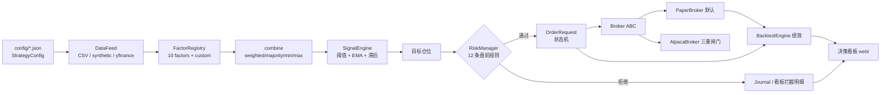

# 架构

## 一句话

**配置 + OHLCV → 因子 → 综合得分 → 信号 → 仓位目标 → 风控闸门 → 订单 → 券商 / 回测撮合 → 绩效与审计。**

回测和实盘共用同一条链路上的因子、信号、风控、订单四层，只有最外面一层不同：回测用内部撮合，实盘用 `Broker` 适配器。这样「回测里成立的风控」在实盘里不会被绕过。



## 模块边界

| 层 | 模块 | 依赖 | 职责 |
| --- | --- | --- | --- |
| 配置 | `config.py` | 标准库 | 策略即数据；加载/校验/序列化 |
| 数据 | `data.py` | 标准库（yfinance 可选） | `Bar` 与数据源适配器 |
| 研究 | `factors.py`, `signals.py` | 标准库 | 纯函数式因子、有状态的信号引擎 |
| 账本 | `portfolio.py`, `orders.py` | 标准库 | 现金/持仓/盈亏、订单状态机 |
| 验证 | `backtest.py`, `metrics.py` | 标准库 | 事件驱动回测、绩效与归因 |
| 防线 | `risk.py` | 标准库 | **所有**下单路径的唯一入口检查 |
| 执行 | `brokers.py`, `live.py`, `journal.py` | 标准库 | 适配器、调度循环、只追加审计 |
| 呈现 | `api.py`, `web/` | FastAPI 可选 / 零依赖 | REST + 浏览器看板 |

关键约束：`quantforge/` 下除 `api.py` 和 `data.py` 的可选适配器外，不导入任何第三方包。`web/engine.js` 是 `factors/signals/portfolio/risk/backtest/metrics` 的逐行移植，由 `scripts/verify_parity.js` 保证数值一致。

## 回测时序（防未来函数）

```
bar t-1 收盘 ── 用 bars[0..t-1] 算信号 ── 生成 OrderRequest 入队
bar t   开盘 ── 按 open×(1±滑点) 成交，扣手续费 ── 风控再次检查
bar t   收盘 ── 按 close 盯市，记录净值
bar t   收盘 ── 用 bars[0..t] 算信号 ── 入队给 t+1
```

决策与执行在代码里是两段独立的循环体（见 `backtest.py`），不是靠注释约定。

## 实盘时序

`LiveTradingEngine.run_cycle()` 是确定性的单周期方法：拉最新 bar → 算信号 → 算目标仓位 → 逐单过风控 → 提交券商 → 写审计。`run()` 只是在外面套一层 `sleep`。这样调度逻辑可以在没有时钟、没有网络的情况下完整测试，`halt()` 可在任意时刻冻结。

## 为什么风控放在订单之前、而不是策略里

策略只表达「我想要什么仓位」，风控决定「允不允许」。把限额写进策略会让每个策略各自实现一套（迟早漏掉一条），而放在统一的 `RiskManager` 里，回测、模拟盘、实盘、手动 API 下单全都必须经过它。
